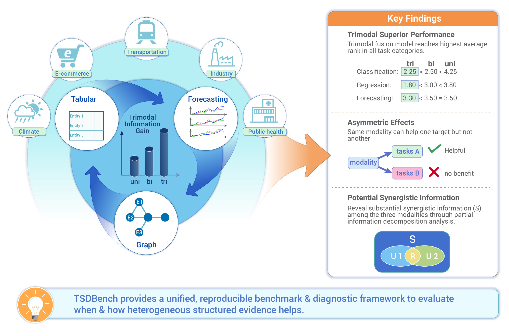

# TSDBench

TSDBench is a multimodal benchmark that brings together **time series, static tabular attributes, and graph structure** across diverse real-world domains. It supports time-series forecasting and node-level prediction tasks, including classification and regression.



## Release Status

**The dataset readers, data-loading code, and task configurations have been uploaded.** Dataset are available on huggingface: 

## Quick Start

Use Python 3.12 and run the following from the repository root:

```bash
python3.12 -m venv TSDRead
source TSDRead/bin/activate
python -m pip install -r requirements.txt
```

Set `dataset_name` and `task_name` in [`load_data.py`](load_data.py) to select a dataset and one of its tasks. For example:

```python
dataset_name = "Store_Sales"
task_name = "store_type_classification"
```

The loader reads `<dataset_name>/dataset.yaml` and `<dataset_name>/tasks/<task_name>/task.yaml`, then creates the PyTorch datasets `train_ds`, `valid_ds`, and `test_ds`. Run it interactively to inspect the loaded data: https://huggingface.co/datasets/stable-ai/TSDBench.

```bash
python -i load_data.py
```

```python
print(len(train_ds), len(valid_ds), len(test_ds))
sample = train_ds[0]
print({key: tuple(value.shape) for key, value in sample.items()
       if hasattr(value, "shape")})
```

Each sample contains the task's input features, graph data, and target `y`. Forecasting time-series tensors use **nodes × variables × time**; node-level classification and regression samples use **time × variables** for historical inputs and a scalar target. Forecasting covariate tensors may have zero variables when no such inputs are used.

## Dataset Overview

TSDBench covers the following ten datasets:

| Dataset | Domain | Contents |
| --- | --- | --- |
| ClimateSet (500 km) | Climate  | Climate-response observations and greenhouse-gas forcing variables over global 500-km grid cells. |
| LargeST | Traffic | Historical traffic observations and road attributes for sensors or road segments, together with the surrounding road-network structure. |
| METR-LA | Traffic | Traffic-speed observations from Los Angeles freeway sensors, together with the road-network graph. |
| TaxiBJ | Traffic  | Taxi mobility over a regular grid covering Beijing. |
| M5 | E-commerce | A large-scale retail dataset containing daily sales and price records for Walmart products across multiple stores and states. |
| Store Sales | E-commerce | Derived from the Corporación Favorita grocery sales dataset. |
| SDWPF | Energy | A large-scale wind-farm SCADA dataset containing multivariate operational and meteorological measurements for spatially distributed wind turbines. |
| Terra | Climate  | A representation of the Earth as a collection of spatially connected geographic points with environmental attributes and temporal observations. |
| Mosqlimate Dengue | Public health | Municipality-level dengue surveillance, environmental, demographic, and spatial information. |
| U.S. COVID-19 (Google Open Data) | Public health | Regional pandemic, mobility, demographic, and geographic information for areas in the United States. |
